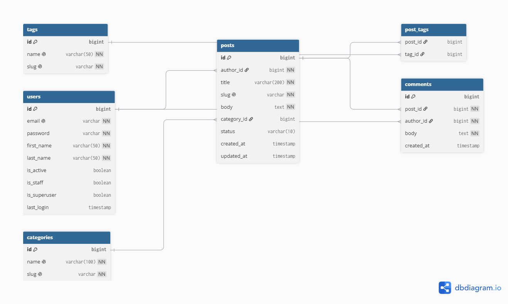
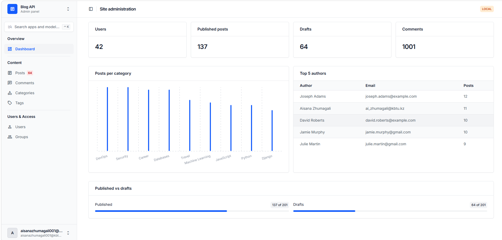
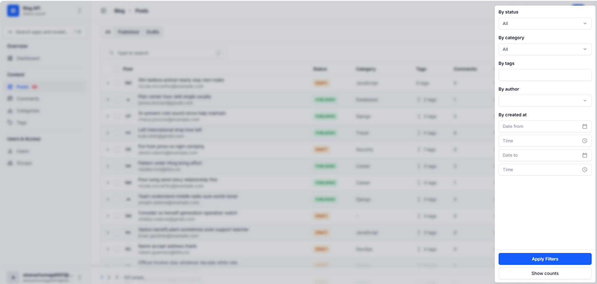
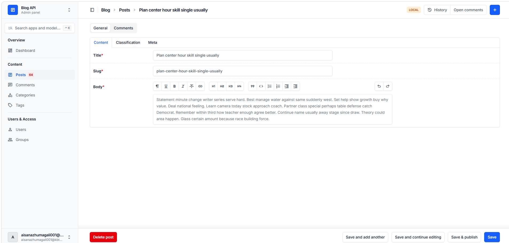
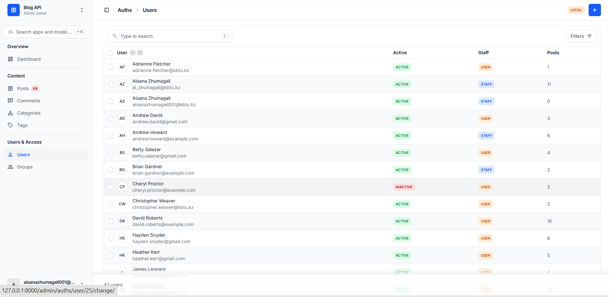

# blog-api

Blog REST API built with Django and Django REST Framework.

## ERD



## Apps

- **auths** — custom user model (login by email), JWT authentication
- **blog** — posts, comments, categories, tags

## Setup

```bash
python -m venv venv
venv\Scripts\activate
pip install -r requirements/dev.txt
```

Create `settings/.env`:

```
BLOG_ENV_ID=local
BLOG_SECRET_KEY=your-secret-key
BLOG_ALLOWED_HOSTS=localhost,127.0.0.1
```

Run:

```bash
python manage.py migrate
python manage.py seed
python manage.py createsuperuser
python manage.py runserver
```

Admin: http://127.0.0.1:8000/admin/

## Seeding

Fill the database with fake data:

```bash
python manage.py seed
```

| Argument     | Default | Description                         |
|--------------|---------|-------------------------------------|
| `--users`    | `20`    | Number of users to create           |
| `--posts`    | `100`   | Number of posts to create           |
| `--comments` | `500`   | Number of comments to create        |
| `--clear`    | off     | Delete existing data before seeding |

Example:

```bash
python manage.py seed --clear --users 50 --posts 300 --comments 1500
```

Output:

```
Users:         50 created
Categories:     8 created
Tags:          20 created
Posts:        300 created
Comments:    1500 created
Done in 2.41 seconds
```

All seeded users have the password `seedpass123`.

## Admin

The admin panel uses [Django Unfold](https://unfoldadmin.com/):

- dashboard with cards, a bar chart, top authors and progress bars;
- custom sidebar, tabs All / Published / Drafts, `Ctrl+K` search;
- filters, colored labels, expandable rows, row / list / detail actions;
- post editor with tabs and a WYSIWYG editor.

### Dashboard


### Post list


### Post edit page


### User list
